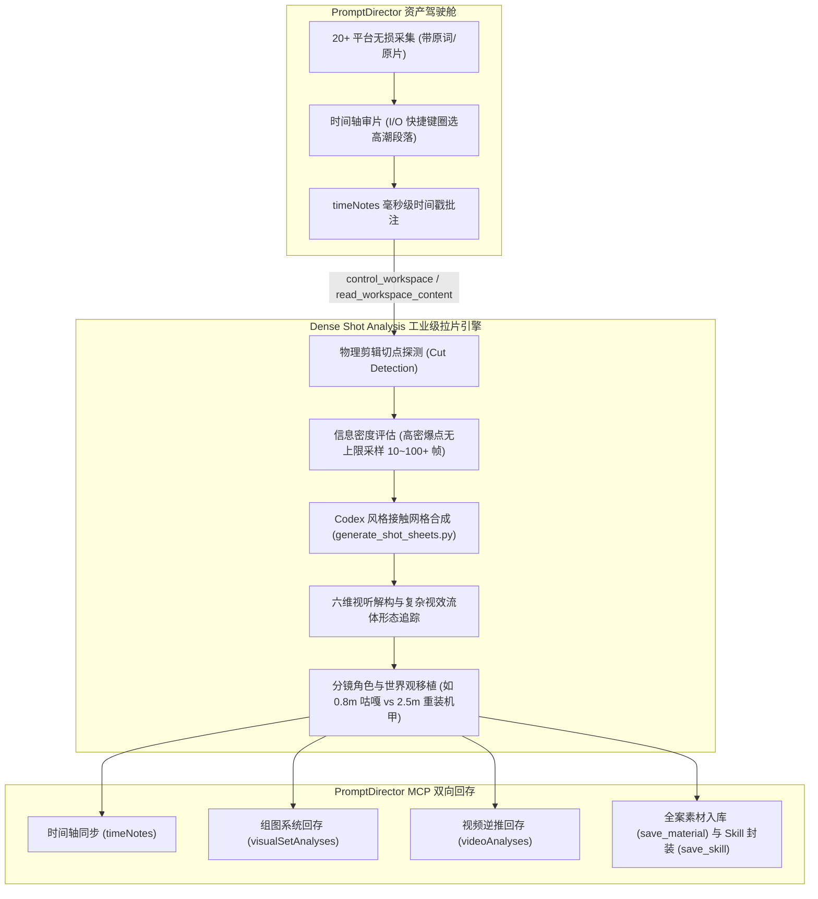

# 视频拉片与复刻 · Video Shot Recreation (v3.0 融合版)

[中文](SKILL.md) | [日本語](SKILL.ja.md) | [English](SKILL.en.md)

本文件是唯一技能入口。本版本为 **工业级逐镜头高密拉片大脑（Dense Shot Analysis）与 PromptDirector 资产管理驾驶舱的深度融合版（Fused Edition）**。

将已看到的画面转化为可核对的毫秒级分镜资产、接触网格组图、六维影视解构与可执行的 AI 视频创作指令，并全面兼容 PromptDirector 原生 Native MCP 协议。

---

## 零、 导演训诫与五大核心军规（用户原话无损记录）

在拉片与分镜复刻全流程中，必须严格恪守以下由总导演提出并定调的实战军规：

> ### 🛑 铁律一：镜头意识与景别调度
> **“而且镜头还是死的，你不会切镜头吗？中景远景特写不知道用吗？我给你的导演skill是空气吗？”**  
> * **执行准则**：严禁全篇单调平视死镜头。必须精准识别并还原镜头语言的递进：极远景（EWS空间建立）→ 仰俯角（俯视压迫/仰角神性）→ 快推特写（Crash Zoom情绪爆点）→ 侧移跟拍（Tracking速度感）。

> ### 🛑 铁律二：Codex 组图规范与六维分析维度
> **“为什么codex的拉片分析是这种组图，你是一张一张的，我希望你也变成组图，每一帧下面增加画面描述，每一组做一个总结，说明此组使用了镜头，有什么视觉效果，完成了什么剧情叙事，人物的动作是什么，人物的行为逻辑是什么，使用了什么拍摄手法，我要一份专业的拉片分析，完整分析这个视频的每一帧，最后把结题报告给我。”**  
> * **执行准则**：严禁散落发图。必须以网格组图（Contact Sheet）集中呈现镜头演变，底部标注毫秒级时间码与动作，每组严格按六维框架归纳：
>   1. **使用的镜头**（景别、运镜轴线、焦段）
>   2. **视觉效果**（光比色温、VFX粒子、流体形态、过曝与负片）
>   3. **剧情叙事**（势力消长、悬念揭晓、攻防逆转）
>   4. **动作力学**（动量传递、预备前摇 Anticipation、碰撞停顿 Hit Stop、随动 Follow-through）
>   5. **行为逻辑与心理**（战术动机、猎手/猎物心理、神性压迫）
>   6. **拍摄手法与剪辑**（切点选择、匹配剪辑、轴线规则、闪白/黑场转换）

> ### 🛑 铁律三：严禁稀疏抽帧与视觉脑补
> **“逐帧分析呐，你抽的帧太稀疏，遗漏了很多关键信息，产生了很多离谱的错误。还是太稀疏，先分析前三十秒吧。”**  
> * **执行准则**：严禁大跨度抽帧（如跳跃数秒），禁止凭空脑补画面未发生的信息。长视频优先锁死核心动作段落（如前 30 秒高潮），拉高抽帧密度。

> ### 🛑 铁律四：一个镜头一组，深挖形态演变与真实物理
> **“时间给你砍到30秒还做得这么粗糙，就拿这个举例，浩克根本没有冲出火雾，你少截了几帧，所以忽视了这个信息，其次，金色气浪冲击波是这个片段的核心视效，这个气浪的形态变化正是凸显其冲击力的关键手法，结果你就截了一帧，给我逐帧分析，一个镜头一组，不要偷懒，30s已经很短了，我没法再给你更多空间了。”**  
> * **执行准则**：
>   1. **一个镜头一组（One Shot, One Group）**：以剪辑切点（Cut Point）为唯一法定边界，每一个连续镜头单独成组。
>   2. **核心视效形态完整追踪**：复杂视效（如爆炸气浪、冲击波、魔法阵）往往跨越数个镜头并发生几何形态演化（如：聚能坍缩核 → 垂直引力拱门 → 贴地旋转涡流 → 半球巨穹顶与双马赫环），必须逐帧追踪形变全程。
>   3. **核实主体真实位置**：绝不脑补角色位移。主体在烟雾核心即记录为核心，出拳未收招即记录为未收招。

> ### 🛑 铁律五：信息密度自适应采样（无上限原则）
> **“网格不限定几帧，如果信息密度高那么100帧也行，如果信息密度低，画面变化少，那么十几帧也行，关键是要保留原本的信息，这样分析才不会遗漏和错误。”**  
> * **执行准则**：
>   1. **打破固定帧数教条**：废除“必须固定 6 帧或 12 帧”的刻板框架。抽帧数量唯一取决于**画面的信息变化率（Information Density）**。
>   2. **高密度变化段（无上限超密抽帧）**：对撞击瞬间（Impact Frame）、爆炸聚能与爆心扩散、冲击波形态变异、超高速攻防转折等瞬态节点，抽 24 帧、48 帧、乃至 100 帧均可，必须完整重现每一个物理分形与形变切片。
>   3. **低密度变化段（精练有效采样）**：对于环境全景建立、长时间蓄势对峙、匀速悬停等画面变化较少的段落，抽十几帧即可提炼其时空节律。
>   4. **唯一终极标准**：**“保留全部原本信息”**。只要画面出现了新的形态特征或动作微步，就必须在网格中独立呈现，坚决杜绝因偷懒控帧而导致的关键信息遗漏与事实性错误！

---

## 一、 PromptDirector 深度融合哲学与工作约定

融合版吸收了 [PromptDirector](https://github.com/wchao6891/PromptDirector) 的工业级架构精髓，确立以下工作守则：

1. **本地优先与零云端依赖 (Local-First)**：
   - 素材原件、抽帧切片、提示词矩阵与分析数据保存在本地文件系统与本地资料库中，绝不在未经用户许可下上传第三方未授权云端。
2. **完整资料优先 (Data Integrity First)**：
   - 严格维护参考原片、原作者原始提示词（Original Prompt）、镜头时间码与分析结论的对应关系。
   - **客观事实 vs AI 推断隔离**：画面客观记录绝不脑补；AI 逆推提示词与建议在回存时明确打标为 `ai-suggestion`，绝不篡改人类原词。
3. **真实现场优先 (Human-in-the-Loop Timeline)**：
   - 尊重创作者在 PromptDirector 前端设定的入点（`I`）、出点（`O`）与时间点笔记（`timeNotes`）。
   - 外部 Agent 产生的分析成果作为可审阅方案提交，不盲目覆盖创作者现场修改。
4. **界面与输出减法原则**：
   - 结题报告严禁充斥无意义的套话与寒暄，直接呈现高信息密度的组图、六维表格、物理演变与提示词矩阵。

---

## 二、 融合版双引擎架构 (Dual-Engine Pipeline)



---

## 三、 PromptDirector MCP 数据映射与工具链

当运行在支持 PromptDirector MCP 连接器的环境中时，拉片分析成果与 PromptDirector 原生数据结构实现 1:1 映射：

| 本系统产出 | PromptDirector 协议字段 / 工具 | 作用 |
|---|---|---|
| **镜头起止时间与核心爆点** | `timeNotes: [{assetId, startMs, endMs, text}]` | 在浏览器播放器时间轴上直接展示导演反馈与镜头标记 |
| **Codex 接触网格组图** | `visualSetAnalyses: [{assetIds, sharedVisualSystem, differences, continuity, compositionRules, reusablePrompt}]` | 记录组图内各帧的角色分工、光影影调、动作连续性与构图规则 |
| **镜头逆推与视效标签** | `videoAnalyses: [{reconstructionPrompt, tags, uncertainties, analysisScope}]` | 保存镜头级可复用提示词与多模态视觉标签 |
| **拉片结题全案与分镜资产** | `save_material(title, kind="creation", creative, files, timeNotes)` | 将接触网格图片、完整报告及移植提示词一键存入创作者本地案例库 |
| **提取的影视技法与动作模式** | `save_skill(callName, skillMarkdown, files)` | 将拉片沉淀出的运镜/视效方法打包为可随时调用的 Agent Skill |

---

## 四、 工业级六步拉片执行规范

### 步骤 1：片段圈选与现场读取
- **方式 A（PromptDirector 联动）**：通过 `read_workspace_content(part=selection)` 读取用户在插件中选中的参考视频；或读取审片时间轴的 `I` / `O` 区间。
- **方式 B（独立模式）**：锁定视频高能窗口（如前 30 秒），记录文件路径与元数据。

### 步骤 2：精准物理切点探测（Cut Detection）
- 依据画面硬切（Hard Cut）、闪白（Flash Cut）划分物理镜头，做到**一个镜头一组（One Shot, One Group）**。

### 步骤 3：信息密度自适应组图合成（Adaptive Contact Sheets）
- 调用脚本 `python scripts/generate_shot_sheets.py --video <path> --config <json> --outdir <dir> --export_pd`：
  - **超高密爆点段（冲击瞬间、爆炸引爆、气浪形变）**：无上限采样，抽 24、48、乃至 100 帧；
  - **中低密段（对峙、环境推拉）**：采样 8 ~ 16 帧；
  - 自动排版为暗黑主题网格（`#0d1117`），底部附带 `F[帧号] | [时间码]s [动作/视效微描述]` Badge。

### 步骤 4：逐帧微观记录与六维专业解构
每组产出：
1. **逐帧微观演变**：记录打击接触点（Hit Stop）、受力反馈、原画级负片冲击帧（Impact Frame）、流体几何演变。
2. **六维分析表格**：
   - **使用的镜头**：景别、机位角度、焦段、运镜轨迹。
   - **视觉效果**：色温光比、等离子辉光、流体形变、遮画比例。
   - **剧情叙事**：攻防态势转换、压迫感递进。
   - **动作力学**：前摇（Anticipation）、冲量传导、反作用力、随动（Follow-through）。
   - **行为逻辑与心理**：战术意图、猎手/猎物位势。
   - **拍摄手法与剪辑**：切点节奏、匹配剪辑、轴线与视觉暂留利用。

### 步骤 5：分镜移植与提示词矩阵（Prompt Matrix）
1. **角色映射与反差重构**：如将均等力量对抗重构为“0.8m 二头身金瞳咕嘎 vs 2.5m 重型外骨骼特工”。
2. **生成 Seedance 2.5 / Midjourney / Sora 可执行提示词矩阵**：按镜头输出，含镜头语言、主体动作、物理材质与渲染参数。

### 步骤 6：双向资产持久化
- 生成 `promptdirector_export.json`，通过 MCP `save_material` 或批次分析接口回存入库，并可沉淀为本地专属影视 Skill。

---

## 五、 自动化脚本与工具调用

核心脚本 `scripts/generate_shot_sheets.py` 已深度内置 PromptDirector 协议支持：

```bash
# 生成接触网格并一键导出 PromptDirector MCP 专用 JSON 数据
python scripts/generate_shot_sheets.py \
  --video "reference_video/action_clip.mp4" \
  --config "scripts/example_shot_config.json" \
  --outdir "output/" \
  --export_pd
```

导出的 `output/promptdirector_export.json` 包含：
- `timeNotes`（可直接导入视频播放时间轴）
- `visualSetAnalyses`（组图系统解构）
- `videoAnalyses`（视频逆推提示词与多模态标签）
- `saveMaterialPayload`（一键入库结构包）

---

## 六、 交付自检清单

- [ ] 是否做到**一个镜头一组（One Shot, One Group）**，物理切点清晰无误？
- [ ] 是否贯彻**信息密度自适应采样（无上限原则）**？剧烈动作与气浪形变是否抽足关键帧？
- [ ] 是否彻底杜绝**凭空脑补**（主体真实位置与未收招状态如实记录）？
- [ ] 关键视效的**几何形态演化（Morphology）**是否追踪完整（聚能坍缩 $\rightarrow$ 贴地涡流 $\rightarrow$ 半球巨穹顶）？
- [ ] 每组是否均配备了 **Codex 暗黑接触网格组图** 与 **六维专业总结表**？
- [ ] 是否导出了兼容 **PromptDirector MCP** 的结构化数据（`timeNotes` / `visualSetAnalyses` / `save_material`）？
- [ ] 结题全案是否提供角色设定映射法则与直接可执行的 **Prompt 矩阵**？
