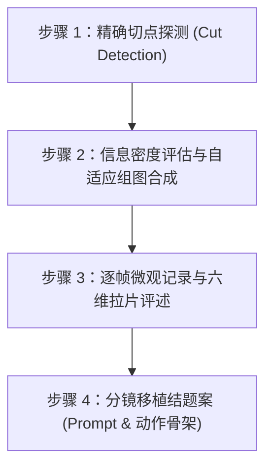

# 视频拉片与复刻 · Video Shot Recreation (v2.0)

[中文](SKILL.md) | [日本語](SKILL.ja.md) | [English](SKILL.en.md)

本文件是唯一技能入口；日文和英文文件是完整译本，不另行注册技能。按用户语言交付；用户指定提示词语言时遵从指定。阅读一种语言版本即可，无需重复加载三份。

把已看到的画面变成可核对的分镜与可执行的创作指令。适用于动作、表演、产品展示和其他有参考片的任务；动作戏方法只在相关场景使用。

---

## 零、 导演训诫与五大核心军规（用户原话记录）

在拉片与分镜复刻过程中，必须严格遵守以下由总导演提出并校正的实战军规：

> ### 🛑 铁律一：镜头意识与景别调度
> **“而且镜头还是死的，你不会切镜头吗？中景远景特写不知道用吗？我给你的导演skill是空气吗？”**  
> * **执行准则**：严禁全篇单调平视死镜头。必须精准识别并还原镜头语言的递进：极远景（EWS空间建立）→ 仰俯角（俯视压迫/仰角神性）→ 快推特写（Crash Zoom情绪爆点）→ 侧移跟拍（Tracking速度感）。

> ### 🛑 铁律二：Codex 组图规范与六维分析维度
> **“为什么codex的拉片分析是这种组图，你是一张一张的，我希望你也变成组图，每一帧下面增加画面描述，每一组做一个总结，说明此组使用了镜头，有什么视觉效果，完成了什么剧情叙事，人物的动作是什么，人物的行为逻辑是什么，使用了什么拍摄手法，我要一份专业的拉片分析，完整分析这个视频的每一帧，最后把结题报告给我。”**  
> * **执行准则**：严禁散落发图。必须以网格组图（Contact Sheet）集中呈现镜头演变，底部标注毫秒级时间码与动作，每组严格按六维框架归纳：
>   1. **使用的镜头**（景别、运镜轴线、焦段）
>   2. **视觉效果**（光比色温、VFX粒子、流体形态、过曝与负片）
>   3. **剧情叙事**（势力消长、悬念揭晓、攻防逆转）
>   4. **动作力学**（动量传递、预备前摇 Anticipation、碰撞停顿 Hit Stop、随动 Follow-through）
>   5. **行为逻辑与心理**（战术动机、猎手/猎物心理、神性压迫）
>   6. **拍摄手法与剪辑**（切点选择、匹配剪辑、轴线规则、闪白/黑场转换）

> ### 🛑 铁律三：严禁稀疏抽帧与视觉脑补
> **“逐帧分析呐，你抽的帧太稀疏，遗漏了很多关键信息，产生了很多离谱的错误。还是太稀疏，先分析前三十秒吧。”**  
> * **执行准则**：严禁大跨度抽帧（如跳跃数秒），禁止凭空脑补画面未发生的信息。长视频优先锁死核心动作段落（如前 30 秒高潮），拉高抽帧密度。

> ### 🛑 铁律四：一个镜头一组，深挖形态演变与真实物理
> **“时间给你砍到30秒还做得这么粗糙，就拿这个举例，浩克根本没有冲出火雾，你少截了几帧，所以忽视了这个信息，其次，金色气浪冲击波是这个片段的核心视效，这个气浪的形态变化正是凸显其冲击力的关键手法，结果你就截了一帧，给我逐帧分析，一个镜头一组，不要偷懒，30s已经很短了，我没法再给你更多空间了。”**  
> * **执行准则**：
>   1. **一个镜头一组（One Shot, One Group）**：以剪辑切点（Cut Point）为唯一法定边界，每一个连续镜头单独成组。
>   2. **核心视效形态完整追踪**：复杂视效（如爆炸气浪、冲击波、魔法阵）往往跨越数个镜头并发生几何形态演化（如：聚能坍缩核 → 垂直引力拱门 → 贴地旋转涡流 → 半球巨穹顶与双马赫环），必须逐帧追踪形变全程。
>   3. **核实主体真实位置**：绝不脑补角色位移。主体在烟雾核心即记录为核心，出拳未收招即记录为未收招。

> ### 🛑 铁律五：信息密度自适应采样（无上限原则）
> **“网格不限定几帧，如果信息密度高那么100帧也行，如果信息密度低，画面变化少，那么十几帧也行，关键是要保留原本的信息，这样分析才不会遗漏和错误。”**  
> * **执行准则**：
>   1. **打破固定帧数教条**：废除“必须固定 6 帧或 12 帧”的刻板框架。抽帧数量唯一取决于**画面的信息变化率（Information Density）**。
>   2. **高密度变化段（无上限超密抽帧）**：对撞击瞬间（Impact Frame）、爆炸聚能与爆心扩散、冲击波形态变异、超高速攻防转折等瞬态节点，抽 24 帧、48 帧、乃至 100 帧均可，必须完整重现每一个物理分形与形变切片。
>   3. **低密度变化段（精练有效采样）**：对于环境全景建立、长时间蓄势对峙、匀速悬停等画面变化较少的段落，抽十几帧即可提炼其时空节律。
>   4. **唯一终极标准**：**“保留全部原本信息”**。只要画面出现了新的形态特征或动作微步，就必须在网格中独立呈现，坚决杜绝因偷懒控帧而导致的关键信息遗漏与事实性错误！

---

## 一、 工作约定

- 用户当前明确要求优先；沿用此前仍有效的角色、时长、素材职责和交付约定。新视频先确认内容，不把上一次剧情、人物或动作带入。
- 区分观察事实、目测估计、用户反馈、创作目标与原因假设。成功归因需要证据；作者经验和单次生成不是普适定律。
- 量化可以是核心工具，不能以“模型不保证精确执行”为由删掉有用数字。也不把目标数字伪装成模型必达参数。
- 学习外部方法时保留用户指定的构图、节拍、结局。没有通用的每秒动作上限、固定镜头数或必须反转的故事结构。
- 用户只要文档就完成文档；不索要验证案例作为前置条件。不因方法不完美阻止交付。

---

## 二、 按任务选择交付

| 请求 | 交付物清单 |
|---|---|
| **看看/分析视频** | 实际观看范围、画面对照、时间线和综合结论 |
| **逐帧拉片分析** | **一个镜头一组**；信息密度自适应 Codex 接触网格组图（附时间码与动作 Badge）；逐帧物理微观解构；六维专业总结表；最终结题全案报告 |
| **保留镜头换角色** | 角色映射表、力学与尺度重构法则、素材分工、可执行提示词（含原画冲击帧等关键视效提示） |
| **新版不理想/对比** | 按同一事件对齐版本，定位动作前摇、打击制动、特效形变差异并给具体修法 |
| **只要提示词** | 一份独立可复制的完整提示词矩阵（Prompt Matrix），含参数与负向词 |
| **简单分镜/位置图** | 用低细节几何、运动箭头与空间标记表达，不擅自画成精致成片 |

---

## 三、 工业级四步拉片执行流程

### 步骤 1：精准切点探测（Shot Boundary Detection）
1. 运行 OpenCV 帧间差分或直方图相关性算法（阈值推荐 `diff.mean() > 30` 或 `HISTCMP_CORREL < 0.6`）。
2. 输出切点清单，记录每个 Shot 的起止帧、起止时间与总帧数。区分硬切（Hard Cut）、闪白（Flash Cut）与冲击帧（Impact Frame）。

### 步骤 2：信息密度自适应组图合成（Adaptive Contact Sheets）
1. 调用脚本 `scripts/generate_shot_sheets.py`，根据信息密度自适应排版：
   - 短镜头或爆发瞬态（< 1.0s）：6 - 12 帧高密微步切片；
   - 复杂打斗与流体视效形变：24 帧、48 帧、乃至 100 帧矩阵；
   - 静态对峙与环境建立：8 - 16 帧。
2. 单帧标注 Badge：`F[帧号] | [时间码]s [动作/视效微描述]`。
3. 统一使用暗黑主题（`#0d1117`），导出高质量 JPG 资产。

### 步骤 3：逐帧微观分析与六维总结
对每个 Shot 产出：
- **逐帧描述**：记录动作关键点、接触瞬间、单帧线稿（Impact Frame）、光照突变、流体形态变化。
- **六维提炼表格**：
  1. 使用的镜头
  2. 视觉效果
  3. 完成剧情叙事
  4. 人物动作与力学
  5. 人物行为逻辑与心理
  6. 拍摄手法与剪辑

### 步骤 4：分镜移植结题案（Transplantation Report）
1. **角色与设定映射表**：原片角色与自研角色属性对齐。
2. **核心导演重构法则**：
   - 尺度反差萌力学（如 0.8m 二头身 vs 2.5m 动力机甲）；
   - 视效形态流体演变还原；
   - 原画级负片冲击帧（Impact Frame）移植。
3. **Seedance 2.5 / Midjourney 生成 Prompt 矩阵**：输出分镜头可执行提示词。

---

## 四、 视效形态演变与动作量化

### 1. 复杂视效多态追踪（以气浪冲击波为例）
不能用单帧概括连贯视效，必须记录形变全过程：
- **第一形态（孕育与聚能）**：爆心等离子核心向心坍缩，高压空气拱门/竖立马赫环形成，定向喷流初发；
- **第二形态（涡流推进）**：高速旋转顺时针等离子风暴涡流，贴地犁开深沟与碎石飞溅；
- **第三形态（宏观穹顶与反冲）**：半球形巨型光幕穹顶展开，多重同心马赫环推向视口，超压掀飞群体目标，金烟遮蔽镜头进入黑场。

### 2. 按问题量化表

| 维度 | 可量化项目 | 注意 |
|---|---|---|
| **节奏** | 镜头时长、接触时间、前摇/爆发/恢复、反应镜头占时 | 快切不等于动作快；停留也服务叙事 |
| **攻击** | 主动攻击者数、每轮攻击数、轮次、间隔、命中数 | 分开发起、落空和命中；一次横扫可命中多个目标 |
| **群体** | 同屏可辨认数、遮挡下界、前中后景人数、同时参与数 | 背景总量不等于参与密度；模糊远景用范围或下界 |
| **投射物** | 发射源数、每源数量、每轮总数、传播时长、时间重叠 | 不把一道拖尾的多帧重复计数，也不把一束光拆成多发 |
| **位移** | 起点、终点、屏幕位移、身位距离、到达时间 | 无尺度参照不报真实米数；相机运动需区分 |
| **特效** | 起效事件、持续时长、衰减、遮画比例、形态变异节点 | 区分常亮造型与动态攻击特效 |

---

## 五、 交付自检清单

- [ ] 是否做到**一个镜头一组（One Shot, One Group）**，切点是否精准对应物理剪辑点？
- [ ] 抽帧是否符合**信息密度自适应（无上限原则）**？高频爆点与流体演变是否抽足帧数？
- [ ] 是否存在主观脑补（如误将爆心未收招记录为冲出火雾）？
- [ ] 关键视效的**几何形态演化（Morphology）**是否逐帧追踪完整？
- [ ] 每组是否均配备了**Codex 接触网格组图**与**六维专业分析表**？
- [ ] 结题报告是否包含角色映射、导演力学法则与可执行的 Prompt 矩阵？
